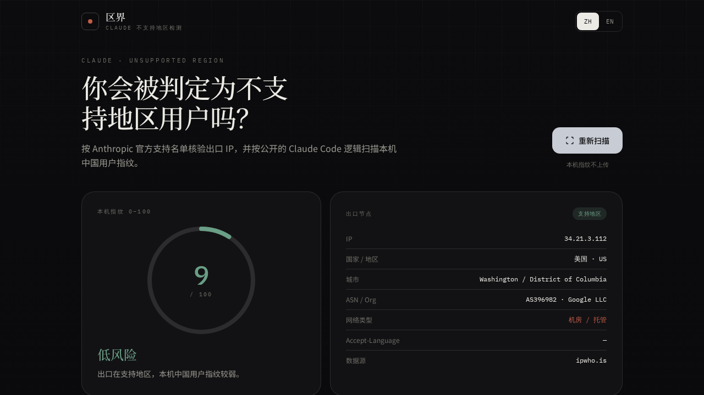

# 区界 Qujie

检测你是否会被 **Claude** 判定为不支持地区 / 中国用户。

对照 [Anthropic 官方支持地区名单](https://www.anthropic.com/supported-countries)，并按公开的 Claude Code 逆向逻辑扫描本机时区、语言、字体与 WebRTC 指纹。

**[打开在线检测 →](https://xinian5216.github.io/qujie/)**



## 它做什么

检测分两层，全部在浏览器里完成，指纹不上传。

| 层 | 看什么 | 对应什么 |
| --- | --- | --- |
| **地区层 · 出口 IP** | 当前公网 IP 落在哪个国家 | Claude.ai 对不支持地区返回 `app-unavailable-in-region`。中国大陆、香港、澳门均不在官方名单 |
| **本机指纹 0–100** | 时区、语言、中文字体、国产浏览器、WebRTC 泄露等十项信号 | Claude Code 会读操作系统时区，并可能把它写进 system prompt |

综合判定：

- **中国相关地区 · 官方不可用** — 出口是 CN / HK / MO
- **不支持地区** — 出口国家不在官方名单（俄、伊、朝、古等）
- **出口可用 · 中国用户高风险** — IP 过了，但本机画像很像中国用户
- **中等 / 低风险** — 地区层会放行，指纹强弱不同

另外可以：

- 粘贴 `ANTHROPIC_BASE_URL` 或中转 hostname，核对中国云 / 国产大模型中转关键词
- 按国家名或 ISO 代码查询是否在支持名单里
- 中 / 英切换

## 在线使用

打开 **[https://xinian5216.github.io/qujie/](https://xinian5216.github.io/qujie/)**，点「开始检测」。

出口 IP 会请求公共地理定位接口（[ipwho.is](https://ipwho.is/) / [geojs](https://www.geojs.io/)）。十项本机指纹只在你的浏览器里计算。

## 从源码运行

需要 [Node.js 22+](https://nodejs.org)。

```bash
git clone https://github.com/xinian5216/qujie.git
cd qujie
npm install
npm run dev
```

开发服务器默认 `http://localhost:8080`。

```bash
npm run build      # 生产构建
npm run typecheck  # 类型检查
```

## 检测原理（摘要）

1. **出口 IP**  
   Claude.ai 用 IP 做粗粒度国家判断。不在[支持名单](https://www.anthropic.com/supported-countries)则 302 到地区不可用页。香港、澳门与大陆一样不在名单；台湾在名单内。

2. **时区（Claude Code 原生信号）**  
   换 VPN 只改出口 IP。Claude Code 读的是操作系统 IANA 时区。`Asia/Shanghai` / `Asia/Urumqi` 会把日期格式从 `2026-09-11` 改成 `2026/09/11`，并可能改 system prompt 里的撇号字符。

3. **相关指纹**  
   浏览器语言、简体中文字体、MiSans / HarmonyOS 等厂商字体、国产浏览器 UA、华为/小米/OPPO/vivo 设备线索、WebRTC 公网候选（VPN 未覆盖时会漏真实 IP）。

本工具根据公开名单与公开逆向报告在浏览器本地估算风险。**不是 Anthropic 的实际判定。** 真实风控还会看支付、手机号与账号行为。

## 技术

- 源码：React 19 · TanStack Start · Tailwind v4
- GitHub Pages：纯静态页，同样的检测逻辑跑在浏览器里，无后端

| 目录 | 作用 |
| --- | --- |
| `src/lib/detect/` | 国家名单、指纹、评分、中转域名关键词 |
| `src/hooks/use-scan.ts` | 扫描流程：WebRTC + 本机信号 + 出口 IP |
| `src/routes/index.tsx` | 主界面 |
| `docs/` | GitHub Pages 静态站点 |

## 许可

[MIT](LICENSE)

与 Anthropic / Claude 无关，也不是官方工具。请遵守当地法律与服务条款。
